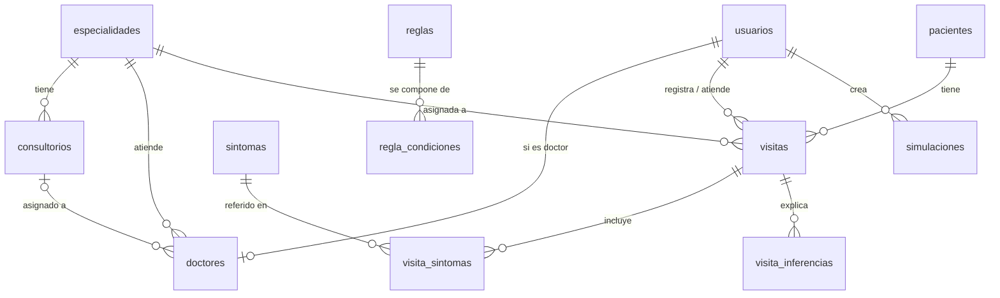

# Base de datos (PostgreSQL)

Esquema en `db/migrations/001_init.sql`. Las migraciones se aplican en orden alfabético y quedan registradas en
la tabla `migraciones`; para cambios futuros cree `002_*.sql`, `003_*.sql`… **sin editar las ya aplicadas**.
`npm run migrate` las aplica a mano; la API también lo hace al arrancar (`AUTO_MIGRATE=true`).

## Diagrama entidad-relación

## Tablas

| Grupo | Tablas |
|---|---|
| Personal y catálogos | `usuarios`, `doctores`, `especialidades`, `consultorios` |
| Pacientes | `pacientes` |
| Sistema experto | `sintomas`, `reglas`, `regla_condiciones` (`negada = true` → exclusión) |
| Operación | `visitas` (con las horas de llegada / inicio / fin de consulta), `visita_sintomas`, `visita_inferencias` |
| Simulación | `simulaciones` (parámetros, resultados y línea de tiempo en JSONB) |

Decisiones de diseño:

- **Las horas de `visitas` alimentan las métricas reales** (`hora_llegada → hora_inicio_consulta` = espera;
  `inicio → fin` = duración de la consulta), que sirven para calibrar la simulación.
- **Índice único parcial** `uq_visita_activa_paciente`: impide dos visitas activas del mismo paciente.
- **`visita_inferencias`** guarda *qué reglas dispararon* en ese momento: el razonamiento sigue disponible
  aunque después se cambien las reglas.
- Las reglas viven en la BD (no en código) para que el administrador ajuste CF sin redesplegar. El **seed es
  idempotente**: no pisa reglas que el equipo ya editó (compara por `codigo`).

## Neon

- Use la cadena **con pooler** (`-pooler` en el host) y `?sslmode=require`.
- El plan gratuito suspende la base tras inactividad: la primera consulta puede tardar unos segundos.
- Cree una **rama** de Neon para desarrollo, separada de producción.
